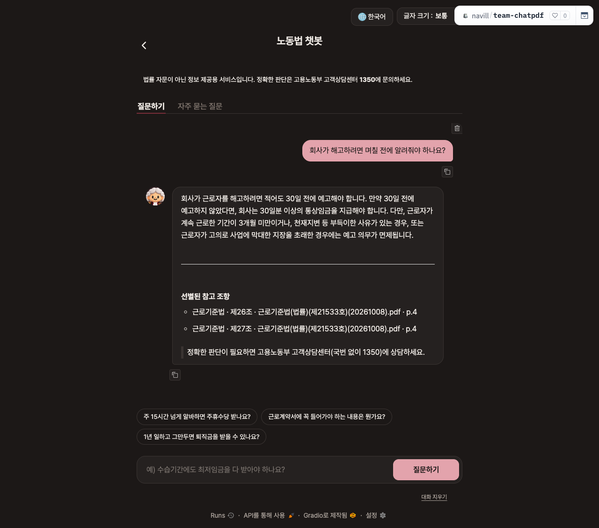
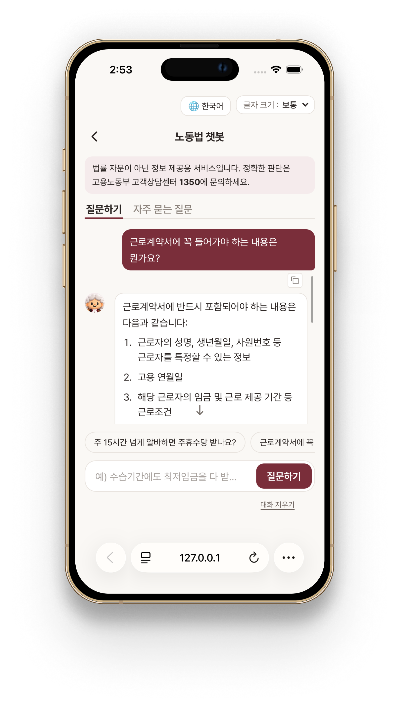
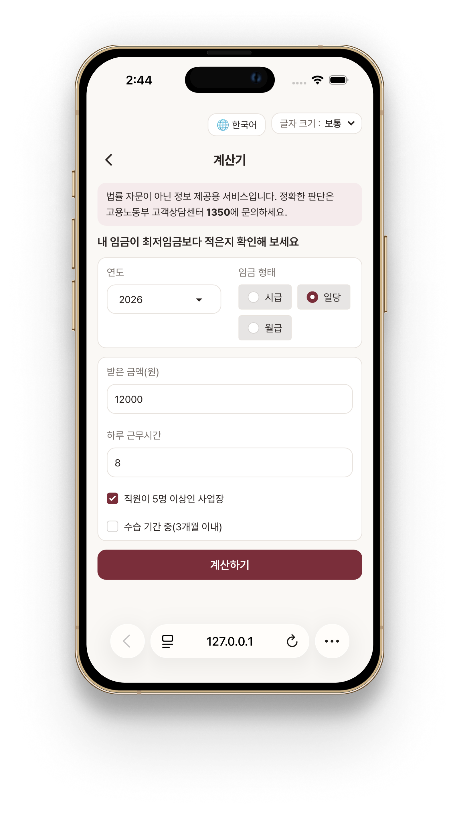
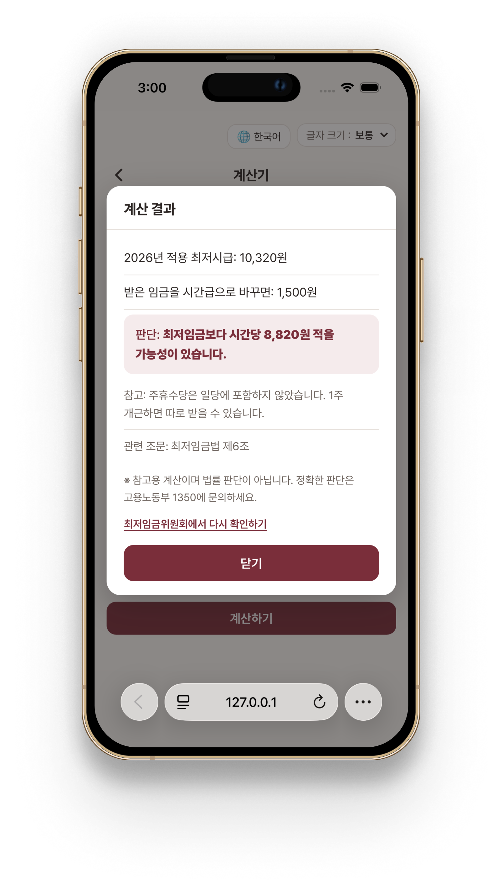

<div align="center">

# 

### 서명하기 전, 근로자의 권리를 확인하는 가장 쉬운 방법

**노동법 조문을 찾아 근거와 함께 설명하는 RAG 기반 AI 안내 챗봇**

> “서명하기 전에, 이 계약서가 법을 지키는지 30초 안에 확인한다”는 프로젝트의 지향점입니다.  
> 현재 구현된 기능은 **노동법 질의응답**이며, 계약서 파일 자동 검토 및 처리 시간 목표는 향후 개발 항목입니다.


**일조 머스크 (1JO Musk) · 팀 프로젝트**

🌐 **배포 주소: [huggingface.co/spaces/navill/team-chatpdf](https://huggingface.co/spaces/navill/team-chatpdf)** · 최종 버전 `v1.0`

[서비스 소개](#intro) · [주요 기능](#features) · [기술 스택](#tech-stack) · [아키텍처](#architecture) · [실행 방법](#quick-start) · [평가](#evaluation)

</div>

---

<a id="intro"></a>

## 💡 프로젝트 소개

근로계약을 체결하거나 근무 중 노동관계법에 관한 의문이 생긴 근로자가 **질문을 입력하면, 보유한 법률 PDF에서 관련 조항을 찾아 이해하기 쉬운 답변과 출처를 제공**하는 서비스입니다.

| 구분               | 내용                                                                             |
| :----------------- | :------------------------------------------------------------------------------- |
| **프로젝트명**     | 서명 잠깐만                                                                      |
| **팀명**           | 일조 머스크 (1JO Musk)                                                           |
| **주요 사용자**    | 아르바이트·단시간 근로자, 사회초년생, 계약직, 중장년·일용직 근로자               |
| **현재 개발 범위** | 노동법 RAG 질의응답, 조문 검색·근거 선별, 조항·페이지 표시, Gradio UI, 평가 도구 |
| **추가 예정**      | 법제처 Open API를 통한 최신 법령 확인, 근로계약서 파일 업로드·자동 검토          |

### 🚨 Why — 어떤 문제를 해결하나요?

| Pain Point                                        | Solution                                               |
| :------------------------------------------------ | :----------------------------------------------------- |
| 법률 용어가 어렵고 필요한 조항을 직접 찾기 어려움 | 자연어 질문에 대해 관련 법률을 검색하고 쉬운 말로 설명 |
| 검색 결과에 질문과 무관한 조문이 포함될 수 있음   | LLM을 활용해 질문에 적용되는 법률 근거를 재선별        |
| 답변만 보고 법률 내용의 근거를 확인하기 어려움    | 법률명·조항 번호·PDF 파일명·페이지를 함께 제공         |

> **안내:** 본 서비스는 법률 정보 제공을 위한 참고 도구입니다. 개별 사건에 대한 법률 자문이나 법률 위반 여부의 최종 판정을 대신하지 않습니다.

---

<a id="features"></a>

## ✨ 서비스 미리보기

**배포 화면 (v1.0)**: 배포 주소에서 "회사가 해고하려면 며칠 전에 알려줘야 하나요?"를 물었을 때의 답변과 근거 조문



<table>
  <tr>
    <td width="33%"></td>
    <td width="33%"></td>
    <td width="33%"></td>
  </tr>
  <tr>
    <td width="33%"></td>
    <td width="33%"></td>
    <td width="33%"></td>
  </tr>
</table>

---

<a id="tech-stack"></a>

## 🛠️ 기술 스택

### Language & UI


### RAG & AI


| 영역      | 적용 기술                                                    |
| :-------- | :----------------------------------------------------------- |
| 문서 로딩 | `PyPDFLoader`                                                |
| 청크 분할 | 정규표현식 기반 조문 분할 + `RecursiveCharacterTextSplitter` |
| 임베딩    | OpenAI `text-embedding-3-large`                              |
| 벡터 저장 | `ChromaDB`                                                   |
| 검색      | `MultiQueryRetriever`                                        |
| 근거 선별 | `ChatPromptTemplate`, LCEL, JSON Schema 구조화 출력          |
| 답변 생성 | `gpt-4o-mini`, 스트리밍 출력                                 |
| 평가      | `eval/run_eval.py`, CSV 평가 질문셋                          |

---

<a id="architecture"></a>

### 📚 지식베이스 구성

국가법령정보센터에서 확보한 **법령 11건과 노동법 관련 판례·평석 자료 1건**, 총 **PDF 12건(375페이지)**을 활용했습니다.

| 구분      | 구성                                                                        |
| :-------- | :-------------------------------------------------------------------------- |
| 전처리    | `제17조(근로조건의 명시)` 형식의 조문 제목을 인식하고 페이지 간 텍스트 연결 |
| 긴 조문   | 800자 단위·150자 겹침으로 추가 분할                                         |
| 저장 정보 | `law_name`, `article_no`, `article_title`, `source`, `page`, `page_end`     |
| 결과      | **2,858개 청크**를 ChromaDB에 저장                                          |

문서별 출처는 [`docs/sources.md`](docs/sources.md)에서 확인할 수 있습니다. 원본 PDF와 로컬 벡터DB는 GitHub 저장소에 포함하지 않습니다.

---

## 🔧 RAG 개선 과정

| 발견한 문제                                | 개선 방법                             | 확인한 결과                                            |
| :----------------------------------------- | :------------------------------------ | :----------------------------------------------------- |
| 고정 길이 분할로 법률 조문이 중간에 잘림   | 조문 경계 기반 분할 및 페이지 간 연결 | 근로기준법 제17조의 핵심 내용을 한 문맥에서 활용       |
| 유사한 표현의 상법 조항이 검색 상위에 등장 | LLM 기반 질문 관련성 재선별           | 근로계약서 질문에서 상법 제96조가 최종 근거에서 제외됨 |
| 복합 질문에서 하나의 핵심 근거만 선택됨    | 쟁점별 핵심 조항 선택                 | 미지급 임금 제36조와 퇴직금 제9조를 함께 선택          |
| 서면 교부 의무를 계약 성립 요건과 혼동     | 법률 답변 프롬프트 개선               | 계약 성립과 서면 교부 의무를 구분해 답변               |

---

## 📂 프로젝트 폴더 구조

<details>
<summary>📁 주요 디렉터리 펼쳐보기</summary>

```text
ChatPDF/
├── app.py                    # Gradio 앱 진입점
├── preprocessing.py          # 조문 기반 전처리 · ChromaDB 구축
├── rag/
│   ├── answer_chain.py       # 검색 · 답변 생성
│   ├── evidence_selector.py  # 질문 쟁점별 근거 조항 선별
│   ├── prompts.py            # 법률 답변 지침
│   └── source_formatter.py   # 출처 및 페이지 표시
├── ui/
│   ├── layout.py             # 화면 레이아웃
│   ├── events.py             # UI 이벤트
│   ├── chat_actions.py       # 챗봇 실행 및 DB 불러오기
│   └── style.css             # 스타일
├── docs/
│   ├── sources.md            # 법령 출처
│   └── images/               # README용 실행 화면
├── eval/
│   ├── questions.csv         # 기본 평가셋
│   ├── holdout.csv           # 별도 검증셋
│   ├── run_eval.py           # 평가 실행
│   ├── compare.py            # 결과 비교
│   ├── REPORT.md             # 평가 요약 및 실패 사례
│   └── README.md             # 평가 방법
├── .env.example              # 환경변수 예시
├── requirements.txt
└── README.md
```

</details>

> 실제 소스의 `rag/answer_chain.py`에서 근거 선별 모듈을 호출하는지, `eval/` 파일 구조가 최신 브랜치와 일치하는지는 PR 전에 확인해 주세요.

---

<a id="quick-start"></a>

## 🚀 로컬 실행 방법

<details open>
<summary><b>1. 설치 및 환경변수 설정</b></summary>

**준비물:** Python 3.11, OpenAI API 키, 인덱싱할 법률 PDF 파일

```bash
git clone https://github.com/TEAM-SPACEH/ChatPDF.git
cd ChatPDF
python -m venv .venv
# Windows Git Bash
source .venv/Scripts/activate
pip install -r requirements.txt
```

`.env.example`을 복사해 `.env`를 만들고 API 키를 설정합니다.

```bash
cp .env.example .env
```

```dotenv
OPENAI_API_KEY=YOUR_OPENAI_API_KEY
```

</details>

<details>
<summary><b>2. 법률 PDF 전처리 및 벡터DB 구축</b></summary>

법률 PDF를 `docs/노동관련법/` 폴더에 배치한 후 실행합니다.

```bash
python preprocessing.py --dry-run  # 전처리 미리보기 (API 비용 없음)
python preprocessing.py            # 임베딩 및 DB 생성 (API 비용 발생)
```

이미 `chroma_db/`가 존재하면 중복 구축을 막기 위해 중단할 수 있으므로, 삭제 전에 데이터를 백업하세요.

</details>

<details>
<summary><b>3. Gradio 실행</b></summary>

```bash
python app.py
```

터미널에 표시된 로컬 주소로 접속합니다. 실행 오류가 발생하면 `.env` 설정과 `chroma_db/`의 존재 여부를 먼저 확인하세요.

</details>

### 배포 (Hugging Face Spaces)

- 주소: https://huggingface.co/spaces/navill/team-chatpdf (`v1.0` = main `d72adff`)
- 하드웨어: ZeroGPU (Free). 무료 CPU Basic은 PRO 구독이 필요해 ZeroGPU를 쓰고, 앱은 GPU를 쓰지 않습니다 (`app.py`의 빈 `@spaces.GPU` 함수 참고)
- `OPENAI_API_KEY`는 Space의 **Secret**으로만 등록합니다.
- `chroma_db/`와 원본 PDF는 git에 없으므로, main 코드(`git archive origin/main`)와 로컬 `chroma_db/`를 `hf upload`로 함께 올립니다. main을 바꾸면 같은 방법으로 다시 올려 **main = 배포 코드**를 유지합니다.

---

<a id="evaluation"></a>

## 📊 성능 평가

### 목표 지표

| 지표                         |      목표 | 측정 기준                              |
| :--------------------------- | --------: | :------------------------------------- |
| 답변 정답률                  |  80% 이상 | 사실관계 및 적용 요건 수동 채점        |
| 핵심 근거 일치율             |  90% 이상 | 필수 조항이 최종 출처에 포함되는지     |
| 근거 없는 질문의 모름 처리율 |      100% | 범위 밖 질문에 근거 없이 답하지 않는지 |
| 평균 응답 시간               | 10초 이하 | 답변 및 출처 생성 완료까지             |

### 기존 평가 보고서의 개선 전후 결과 (QA 확정 전 초안)

| 지표                |            초기 RAG | 개선 버전 (평가 #33 기준) |
| :------------------ | ------------------: | ------------------------: |
| 답변 정답률         |               41.7% |                 **90.0%** |
| 핵심 근거 일치율    | 0% (출처 표시 없음) |                 **96.2%** |
| 모름 처리율 (4문항) |                 25% |                       75% |
| 평균 응답 시간      |               3.3초 |                     4.3초 |
| 별도 검증 정답률    |               45.0% |                      100% |

> **평가 수치 안내:** 위 수치는 [`eval/REPORT.md`](eval/REPORT.md)에 기재된 것으로 정리한 QA 확정 전 초안입니다. 채점 기준, 분모, 평가 당시 코드 버전은 병합 전에 보고서 원본과 대조해야 합니다. '핵심 근거 일치율'은 **필수 핵심 조항의 포함 여부**를 뜻하며 모든 표시 출처의 정밀도를 뜻하지 않습니다. 현재 배포 앱의 실측 성능을 보증하지 않습니다.

평가 방법 및 실패 사례: [`eval/README.md`](eval/README.md) · [`eval/REPORT.md`](eval/REPORT.md)

---

## ⚠️ 이용 안내 및 보안

- **법률 안내의 한계:** 제공된 문서와 LLM에 기반한 안내이며, 구체적 사건의 법률 자문이나 공식 판정을 대신하지 않습니다.
- **최신성:** 법제처 Open API 기반 현행 법령 자동 확인은 별도 연동이 필요합니다. 최신 개정·시행 여부는 [국가법령정보센터](https://www.law.go.kr/)에서 확인해 주세요.
- **전문 상담:** 개별 노동 사건 상담은 고용노동부 고객상담센터 **1350**을 이용할 수 있습니다.
- **개인정보:** 주민등록번호, 계좌정보 등 민감한 내용을 질문에 입력하지 마세요. 입력 내용이 외부 LLM API로 전달될 수 있습니다.
- **API 키 보안:** `.env` 및 배포 환경 비밀 설정으로 관리하고 공개 저장소에 올리지 않습니다.

---

## 👥 팀 구성 및 역할

| 역할             | 담당자         | 주요 업무                                                |
| :--------------- | :------------- | :------------------------------------------------------- |
| 기획 · 자료 조사 | 이승준, 박예원 | 프로젝트 기획, 법령·판례 조사, 출처 및 문서 관리         |
| RAG 개발         | 정재연, 김소은 | PDF 전처리, 임베딩·벡터DB, 검색·근거 선별, 답변 프롬프트 |
| UI 개발          | 이서현, 이상훈 | Gradio 화면 구성, 스타일, 사용자 입력·출력 연결          |
| QA · 평가        | 이현종         | 평가 질문셋, 정량 지표, 오류·실패 사례 분석              |

---

<div align="center">

**서명하기 전, 권리를 먼저 확인하세요.**

<sub>일조 머스크 · 법률 정보 제공을 위한 학습 프로젝트</sub>

</div>
